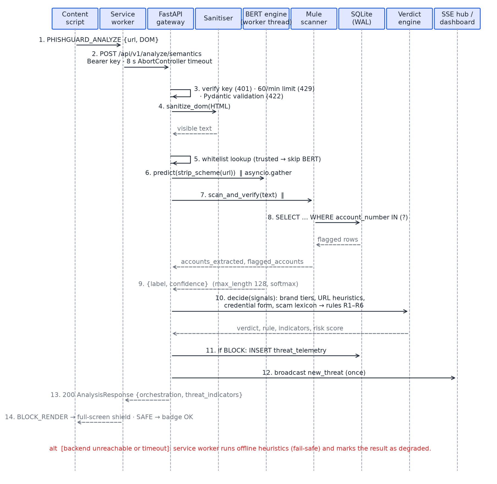
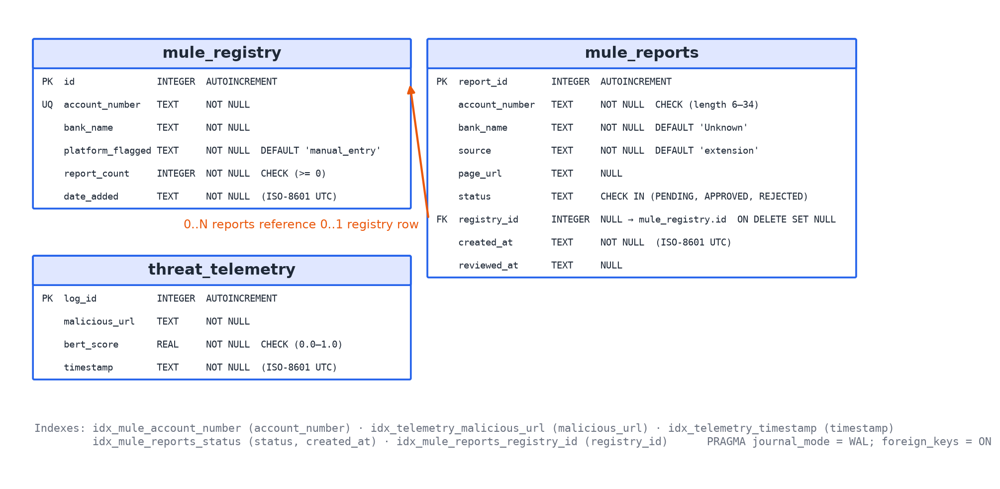

<!-- Generated from PhishGuard-AI_Project_1_&_2_Report_LiewYiLer.docx (v3.2.0, 16 November 2026). The Word document is the authoritative version; edit it, not this file. -->

# Chapter 4

## System Design

### 4.1 Introduction & Architectural Principles

The System Design phase represents the critical engineering bridge that translates the theoretical cybersecurity methodologies, non-functional constraints, and mathematical metrics formulated in Chapter 3 into concrete, executable technical blueprints. In enterprise-grade security engineering, deploying computationally intensive deep learning models alongside real-time web interceptors requires an architecture that keeps response times low and avoids false alarms on legitimate banking portals, and complete data privacy.

This chapter details the comprehensive structural, behavioural, and persistence architecture of the **Semantic Threat Intelligence and Mule Account Verification Engine** developed as an individual module by Liew Yi Ler.

The architectural design of the backend is governed by five core foundational principles:

- **Decoupled N-Tier Microservices Topology**: Isolates computationally heavy PyTorch tensor operations and database queries from the client-side Google Chrome extension, preventing client browser thread blocking (Newman, 2015).
- **Zero Trust Edge Verification (ZTA)**: Enforces NIST SP 800-207 principles ("Never Trust, Always Verify"), evaluating raw DOM payloads independently of SSL/TLS certificates or domain age.
- **Singleton In-Memory Model Management**: Employs the Singleton design pattern (Gamma et al., 1994) to load the 440 MB BERT Transformer model into system RAM strictly once during server initialisation, eliminating run-time disk I/O latency.
- **Asynchronous Non-Blocking Concurrency**: Leverages the Asynchronous Server Gateway Interface (ASGI), offloading CPU-bound operations via asyncio.to_thread() and executing database I/O concurrently using asyncio.gather().
- **Strict Defence-in-Depth Hardening**: Integrates Bearer token authentication, SlowAPI fixed-window rate limiting, Pydantic input sanitisation, and parameterised SQL bindings to guarantee backend resilience.

### 4.2 High-Level System Architecture & N-Tier Decomposition

The PhishGuard-AI backend is architected as a decoupled, multi-tiered client-server system organised into three distinct logical tiers, visualised in Figure 4.1.

*[Figure: see the Word report]*

#### 4.2.1 Tier 1: Client Edge & API Gateway Tier

The Application Gateway Tier operates as the asynchronous, hardened perimeter of the backend service. Deployed on **FastAPI** over the **Uvicorn** Asynchronous Server Gateway Interface (ASGI), it provides:

- **Request Authentication**: Enforces HTTP Authorization: Bearer <API_KEY> headers on all analysis routes, compared in constant time (hmac.compare_digest). Dashboard routes additionally require the administrative key or a server-side session (Section 4.7).
- **Denial-of-Service Protection**: Implements SlowAPI fixed-window rate limiting (60 requests/minute per client IP) to prevent algorithmic exhaustion.
- **Payload Validation & Sanitisation**: Uses Pydantic v2 data transfer models to strictly validate data types, strip executable tags via BeautifulSoup, and catch malformed JSON payloads prior to downstream routing.

#### 4.2.2 Tier 2: Threat Intelligence & Inference Tier (Backend Core)

The processing core executes multi-modal AI and deterministic fraud classification:

- **In-Memory Trusted Domain Whitelist (frozenset)**: Evaluates the request hostname against verified Malaysian financial institutions (maybank2u.com.my, pbebank.com, cimbclicks.com.my) and a list of major global platforms, matching exact hosts and subdomains. A whitelisted page skips model inference (mean 0.28 ms in the benchmark) and is never blocked. Domains under which the public can publish pages, such as web.app or vercel.app, are deliberately excluded.
- **BERT URL Classifier (PyTorch Singleton)**: Loads the fine-tuned bert-base-uncased model once at start-up. Each request passes the scheme-stripped URL through WordPiece tokenisation (maximum 128 tokens) and a forward pass executed in a worker thread via asyncio.to_thread(); the softmax output gives the label and its confidence. A PHISHING label at or above the 0.75 threshold is a supporting signal, never a verdict.
- **Mule Account Verification Engine**: Executes pre-compiled Regular Expression (Regex) bytecode tailored to 8 Malaysian bank account formats, extracting numerical strings and querying the database without thread blocking.
- **Brand Impersonation Profiler**: Distinguishes three tiers of evidence: a protected brand string embedded in a hostname the brand does not own, a look-alike of a brand string found by homoglyph normalisation and bounded Levenshtein distance (rnaybank2u.com), and a brand merely named in the page text.
- **Optical Quishing Decoder**: Utilises OpenCV cv2.QRCodeDetector() to decode embedded EMVCo Merchant-Presented DuitNow QR codes from base64 images.
- **Corroborated Verdict Engine:** Reduces the outputs of all detectors to a vector of eleven boolean signals and applies rules R1–R6 (Section 4.6.1). It returns the orchestration directive, the rule that fired, a risk score and human-readable indicators.

#### 4.2.3 Tier 3: Data Persistence & Telemetry Tier

The persistence layer provides non-blocking relational storage and real-time security event broadcasting:

- **SQLite Database in WAL Mode**: Three tables (mule_registry, threat_telemetry and mule_reports) with one foreign key and five B-Tree indexes, operating under Write-Ahead Logging (WAL) with foreign-key enforcement enabled and accessed asynchronously through aiosqlite.
- **Server-Sent Events (SSE) Hub**: Broadcasts real-time threat telemetry events to active Security Operations Centre (SOC) dashboard clients over persistent HTTP connections.
- **CTI & Law Enforcement Exporters**: Synthesises threat records into standardised **OASIS STIX 2.1 JSON bundles**, ArcSight CEF logs, and case summaries formatted for hand-off to the National Scam Response Centre (NSRC 997).

### 4.3 System Interfaces, API Contracts & OpenAPI Specifications

#### 4.3.1 RESTful API Interface & OpenAPI Documentation

The backend strictly complies with the **Representational State Transfer (REST)** architectural model (Fielding, 2000). All communications are stateless, utilising standard HTTP response codes and JSON serialised payloads (Crockford, 2006).

FastAPI automatically generates interactive **OpenAPI 3.0 (Swagger UI)** documentation served at /docs, enabling standardised client-server integration testing.

*[Figure: see the Word report]*

#### 4.3.2 REST Endpoint Inventory

The OpenAPI schema generated by the application at version 3.2.0 documents 72 operations. Table 4.1 lists the endpoints used by the browser extension and by API clients; the 64 administrative dashboard operations are grouped in Table 4.5. All request and response bodies are JSON (application/json) and all authenticated routes expect the header Authorization: Bearer <key>.

**Table 4.1: Client-Facing REST Endpoints**

| Method and route | Purpose | Authentication | Rate limit | Success |
| --- | --- | --- | --- | --- |
| POST /api/v1/analyze/semantics<br>(alias /api/v1/analyse/semantics) | Analyse one page: BERT URL classification, mule scan, corroborated verdict | API key (Bearer) | 60/minute per IP | 200 AnalysisResponse |
| POST /api/v1/analyze/quishing<br>(alias /api/v1/analyse/quishing) | Decode a QR image and audit the payload (DuitNow EMVCo, URLs, accounts) | API key (Bearer) | None | 200 QuishingAnalysisResponse |
| POST /api/visual/analyze | Detect bank logos in a screenshot and compare them with the page domain | API key (Bearer) | None | 200 VisualAnalyzeResponse |
| POST /api/v1/mule-reports | Queue a suspected mule account for analyst review | API key (Bearer) | 60/minute per IP | 201 {report_id, status, already_registered} |
| GET /api/v1/mule-registry<br>(alias /api/v1/mules) | Read-only registry listing for the extension popup | API key (Bearer) | None | 200 registry list |
| POST /api/v1/dashboard/auth/login | Exchange the administrative key for a session cookie | None (public) | 5/minute per IP | 200 {authenticated, expires_in} + Set-Cookie |
| GET /api/v1/dashboard/auth/session | Report whether the caller holds a valid session | None (public) | None | 200 {authenticated} |
| POST /api/v1/dashboard/auth/logout | Destroy the session and clear the cookie | None (public) | None | 200 {authenticated: false} |
| GET /health | Liveness probe | None (public) | None | 200 {status, service, version} |

#### 4.3.3 Primary Endpoint Contract: POST /api/v1/analyze/semantics

This endpoint orchestrates the real-time decision pipeline. The request body is validated by the Pydantic model WebPayload before any business logic runs (Table 4.2); a request that fails validation never reaches the model.

**Table 4.2: Request Schema (WebPayload) and Validation Rules**

| Field | Type | Required | Validation rule |
| --- | --- | --- | --- |
| url | string (HttpUrl) | Yes | Must be an absolute http or https URL; otherwise HTTP 422. |
| dom_content | string | One of dom_content / text_content | Raw outerHTML of the page; at most 5,000,000 characters. |
| text_content | string | One of dom_content / text_content | Visible text of the page; at most 5,000,000 characters. |
| origin | string | No | Optional origin or referrer header. |
| extract_mules | boolean | No (default true) | Flag reserved for clients that wish to state mule scanning explicitly. |
| (model rule) | — | — | At least one of dom_content or text_content must contain a non-whitespace character; an empty payload returns HTTP 422. When only one is supplied it is mirrored into the other. |

The response envelope (Table 4.3) keeps the nested meta and data blocks used since Project I and adds top-level fields that explain the verdict. Listing 4.1 shows a response captured from the running system for a look-alike Maybank page.

**Table 4.3: Response Schema (AnalysisResponse)**

| Field | Type | Meaning |
| --- | --- | --- |
| meta.transaction_id | string (UUID v4) | Identifier of this analysis, also written to the server log. |
| meta.processing_time_ms | number | Server-side time for BERT inference and mule scan. |
| data.semantic_analysis | object | label (PHISHING or LEGITIMATE), confidence in [0, 1], is_malicious (label is PHISHING and confidence ≥ 0.75), sanitized_text_preview (first 200 characters). |
| data.mule_scan | object | accounts_extracted (array of strings), flagged_accounts (array of {account_number, bank_name, report_count}), mule_detected (boolean). |
| orchestration / verdict | string | BLOCK_RENDER or SAFE. The extension acts on this field. |
| decision_rule | string or null | Rule that produced a block (R1_MULE_REGISTRY … R6_EVASIVE_INFRASTRUCTURE); null when SAFE. |
| threat_indicators | array of strings | Human-readable reasons for the verdict, shown on the block overlay. |
| signals | object of booleans | The eleven signals evaluated by the verdict engine (Table 4.13). |
| risk_score | number | Severity of the rule that fired (0.90–0.99), or an advisory value below 0.50 when SAFE; 0.0 for whitelisted pages. |
| bert_score | number | Softmax confidence of the label predicted by BERT. |
| is_whitelisted | boolean | True if the hostname matched the trusted-domain whitelist. |
| brand_impersonation | object | target_brand, is_official_domain, brand_in_hostname, lookalike_domain, brand_mentioned, impersonation_index, matched_brand_cues, hostname. |
| mule_accounts_flagged | array | Copy of data.mule_scan.flagged_accounts for convenience. |
| status, execution_time_ms, timestamp | string, number, string | "success"; processing time; ISO-8601 time in GMT+8. |

**Listing 4.1: Captured Response for http://maybank2u-secure-login.top/m2u/login (abridged)**

```
{
  "meta": {
    "transaction_id": "b12c2998-ed8b-4185-83a5-da429cf43ffa",
    "processing_time_ms": 115.64
  },
  "data": {
    "semantic_analysis": {
      "label": "PHISHING",
      "confidence": 0.999911,
      "is_malicious": true,
      "sanitized_text_preview": "Maybank2u Your account access has been limited. Log in and enter the TAC sent to your phone to restore access."
    },
    "mule_scan": {
      "accounts_extracted": [],
      "flagged_accounts": [],
      "mule_detected": false
    }
  },
  "orchestration": "BLOCK_RENDER",
  "decision_rule": "R2_BRAND_IN_HOSTNAME",
  "risk_score": 0.97,
  "threat_indicators": [
    "Hostname embeds protected brand 'Maybank' (maybank) on a domain it does not own",
    "High-risk disposable TLD detected (.top)"
  ],
  "signals": {
    "mule": false,
    "brand_host": true,
    "lookalike": false,
    "brand_mention": false,
    "bert": true,
    "heuristic": true,
    "heuristic_strong": true,
    "credential_form": true,
    "credential_text": true,
    "credential_request": true,
    "scam_language": false
  },
  "bert_score": 0.999911,
  "is_whitelisted": false
}
```
Table 4.4 lists every status code the endpoint can return together with the body the client receives. The same error conventions apply to the other authenticated routes.

**Table 4.4: Status Codes and Error-Handling Schema**

| Status | Condition | Response body | Client behaviour |
| --- | --- | --- | --- |
| 200 OK | Analysis completed | AnalysisResponse (Table 4.3) | Apply the orchestration directive. |
| 401 Unauthorized | Authorization header missing, or the key is wrong | {"detail": "Not authenticated"} or {"detail": {"error": "INVALID_API_KEY", "message": …}} | Treated as a backend error: offline heuristics are used and the error appears in the popup diagnostics. |
| 422 Unprocessable Entity | Malformed URL, empty content, or wrong types | {"detail": [{"type", "loc", "msg", …}]} (Pydantic error list) | Logged as a client error; offline heuristics are used. |
| 429 Too Many Requests | More than 60 requests in a minute from one IP | {"error": "Rate limit exceeded: 60 per 1 minute"} | Offline heuristics are used until the window resets. |
| 503 Service Unavailable | PyTorch out-of-memory or CUDA failure caught by the global RuntimeError handler | {"error": "MODEL_INFERENCE_FAILURE", "message": …} | Offline heuristics are used. |
| 500 Internal Server Error | Any other unhandled exception | FastAPI default error body | Offline heuristics are used. |

#### 4.3.4 Supporting Endpoint Contracts

**Quishing analysis (POST /api/v1/analyze/quishing).** The request carries image_base64 (required) and an optional page_url. The image is decoded with OpenCV's QRCodeDetector and the payload is audited against PayNet EMVCo DuitNow conventions and the URL heuristics. The response contains quishing_threat, quishing_score, decoded_payload, verdict, risk_factors, is_duitnow_scheme, extracted_destination_urls and extracted_mule_accounts. The verdict is BLOCK_RENDER when the score is at least 0.70 or when the payload contains a registry account.

**Visual analysis (POST /api/visual/analyze).** The request carries current_url and screenshot (a data URL or raw base64, at most 15,000,000 characters), with optional page_title and visible_text. The response contains detected_logos (brand, confidence, bounding box), risk_level (safe, suspicious or dangerous) and reason. A logo of a supported bank detected with confidence of at least 0.85 on a domain that the bank does not own yields dangerous; lower confidence yields suspicious. An undecodable screenshot returns HTTP 400 (INVALID_SCREENSHOT) and an unavailable model returns HTTP 503 (VISUAL_MODEL_UNAVAILABLE).

**Mule report (POST /api/v1/mule-reports).** The request carries account_number (6 to 34 characters, digits with optional spaces, dashes or a leading plus sign; anything else returns HTTP 422), an optional bank_name and an optional page_url. The report is stored with status PENDING and HTTP 201 is returned with the report identifier. The account does not enter the blocking registry until an analyst approves the report through POST /api/v1/dashboard/mule-reports/{report_id}/review with the body {"decision": "APPROVE"} or {"decision": "REJECT"}; reviewing a report twice returns HTTP 409 and an unknown identifier returns HTTP 404.

**Dashboard operations.** Every route under /api/v1/dashboard other than the three auth routes requires the administrative key or a valid session cookie and otherwise returns HTTP 401 with the body {"detail": {"error": "DASHBOARD_AUTH_REQUIRED", "message": …}}. Table 4.5 groups the 64 operations (38 GET, 25 POST and 1 DELETE) by function.

**Table 4.5: Administrative Dashboard Operations by Function (all require administrative authentication)**

| Function | Route families under /api/v1/dashboard | Operations |
| --- | --- | --- |
| Telemetry and statistics | stats, telemetry (list, export, per-event report, takedown notice, explanation, sandbox preview), distributions, geo-threats, threat-graph, brand-campaign-matrix, system-health, diagnostics | 14 |
| Live stream | stream (Server-Sent Events: connected, update and heartbeat frames) | 1 |
| Mule registry and reports | mule-registry (list, add, bulk add, delete), mule-reports (list, review) | 6 |
| On-demand analysis | quick-scan, batch-inspect, sandbox-inspect, multi-vector-score, ssl-intel, quishing, typosquat-radar | 8 |
| Threat-intelligence export | export (CEF, Syslog, sinkhole rules and others), taxii2, yara-rules, suricata-rules, mitre-matrix, threat-feeds | 14 |
| Response and administration | domains (quarantine, whitelist), playbooks, nsrc, webhooks, db (maintenance, backup), simulator, red-team | 21 |

#### 4.3.5 Supporting User Interface Wireframes & System Interaction Mockups

To satisfy requirements engineering and user experience (UX) specifications, the backend platform is engineered to interact with two primary front-end graphical interfaces: (1) the **Client-Side High-Impact Alert Interstitial Overlay** (executed in the user's browser upon receiving a BLOCK_RENDER verdict), and (2) the **Enterprise Security Operations Centre (SOC) Live Telemetry Dashboard** (served at /dashboard/ for security analysts and incident response teams).

The two mock-ups below present the architectural wireframes and interface mockups governing these two operational environments.

*[Figure: see the Word report]*

**User Experience (UX) Architecture & Cognitive Safeguard Rationale**

The design of these visual supporting elements is grounded in cognitive cybersecurity principles:

- **Mitigating "System 1" Cognitive Biases (Kahneman, 2011)**: Standard passive browser warnings (e.g. subtle padlock colour alterations) are frequently bypassed because victims browse under automatic, fast-paced cognitive heuristics. The **Client-Side High-Impact Alert Interstitial** dismounts the deceptive DOM from the client rendering tree, replacing it with an un-ignorable high-contrast crimson overlay that disrupts automatic victim momentum and forces conscious, deliberate cognitive evaluation.
- **Actionable Remediation over Ambiguity**: Rather than presenting abstract technical diagnostics, the interstitial explicitly communicates the impersonated banking brand, the quantified AI risk confidence score, and provides a direct, zero-risk hyperlink to the verified official banking website (https://www.maybank2u.com.my).
- **Operational SOC Visual Ergonomics**: The **Threat Intelligence Dashboard** visualises diurnal attack rhythms synchronised to Malaysian business hours (GMT+8), providing tier-1 security operations centre (SOC) analysts with immediate situational awareness and single-click STIX 2.1 / NSRC 997 escalation pathways to execute real-time account freezes.

### 4.4 Unified Modelling Language (UML) Behavioural & Structural Models

To formally specify system interactions, execution flows, and object-oriented architectures, standard **Unified Modelling Language (UML 2.5)** diagrams are utilised (Fowler, 2003).

#### 4.4.1 Use Case Diagram

The Use Case Diagram (Figure 4.2) models the functional boundaries of the backend system and specifies interactions with external actors:

- **Actor 1: Browser Extension Client (End User)**: Dispatches DOM payloads for real-time analysis and receives orchestration directives (BLOCK_RENDER vs. SAFE).
- **Actor 2: SOC Security Administrator**: Monitors live threat telemetry feeds, analyses the 24-hour velocity timeline, manages mule registry entries, and triggers model retraining.
- **Actor 3: Law Enforcement (PDRM CCID / NSRC 997)**: Receives automated STIX 2.1 forensic dossiers and executes emergency account freezing directives.
*[Figure: see the Word report]*

#### 4.4.2 Activity Diagram

The Activity Diagram (Figure 4.3) illustrates the algorithmic decision logic executed upon receiving an API inspection request, highlighting the parallel execution of the BERT NLP forward pass and the Regex database search via asyncio.gather().

*[Figure: see the Word report]*

#### 4.4.3 UML Sequence Diagram

The Sequence Diagram (Figure 4.4) chronologically maps the multi-threaded object interactions during a zero-day phishing interception event.

*[Figure: see the Word report]*

#### 4.4.4 UML Class Diagram

The Class Diagram (Figure 4.5) details the Object-Oriented structure, encapsulation boundaries, and data transfer objects (DTOs) powering the Python backend.

*[Figure: see the Word report]*

#### 4.4.5 Detailed Analysis-Pipeline Sequence and Client State Handling

Figure 4.8 refines the sequence diagram to the level of the implemented components and shows the exact order of operations for a non-whitelisted page that is blocked. Table 4.6 gives the processing performed at each step, with the thresholds and limits taken from the source code.



**Figure 4.8: Detailed Sequence of the Analysis Pipeline (v3.2.0)**

**Table 4.6: Processing Performed at Each Pipeline Step**

| Step | Component | Processing and parameters |
| --- | --- | --- |
| 1 | Content script → service worker | Collects the page URL, visible text (including open shadow roots and same-origin frames) and body HTML; the HTML is truncated to 3,000,000 characters. |
| 2 | Service worker → API | POST with the Bearer key. An AbortController cancels the call after 8 s (12 s for the visual endpoint). |
| 3 | API gateway | Constant-time key check (401), fixed-window limit of 60 requests per minute per IP (429), Pydantic validation (422). |
| 4 | Sanitiser | BeautifulSoup removes script, style, noscript, meta, link, svg and iframe subtrees, extracts visible text and collapses whitespace. |
| 5 | Whitelist | Exact or subdomain match against the trusted-domain sets. On a match BERT is skipped and the verdict is SAFE. |
| 6 | BERT engine | Input: URL without scheme or www. WordPiece tokenisation, truncation and padding to 128 tokens, forward pass under torch.no_grad() in a worker thread, softmax. Results are cached per URL for 10 minutes. |
| 7–8 | Mule scanner and SQLite | Eight bank patterns, DuitNow phone and NRIC patterns and a generic 10–14 digit pattern; matches are normalised (spaces, dashes, +60 prefix) and looked up with one parameterised IN query. |
| 9 | Signal construction | is_malicious is true when the label is PHISHING and the confidence is at least 0.75. |
| 10 | Verdict engine | Brand profiler tiers, URL heuristics, credential-form detection and scam lexicon are combined by rules R1–R6 (Table 4.14). |
| 11–12 | Telemetry | For a blocked page only: one row in threat_telemetry and one SSE update frame to connected dashboards. |
| 13–14 | Response and client action | The extension applies the directive as described in Table 4.7. |

The browser extension, developed by the project partner, turns the response into one of the client states in Table 4.7. The design principle is fail-safe degradation: a slow or unavailable backend never leaves the user waiting and never blocks a page on the basis of a server error.

**Table 4.7: Chrome Extension State Handling for Backend Outcomes**

| Backend outcome | Extension state | User-visible behaviour |
| --- | --- | --- |
| orchestration = BLOCK_RENDER, or a registry account is flagged | risk_level = dangerous | Full-screen red shield overlay listing the indicators returned by the backend; toolbar badge "!" in red; the user may leave the page or explicitly choose to proceed. |
| Visual endpoint reports suspicious (logo confidence below 0.85) | risk_level = suspicious (REVIEW) | Amber "?" badge; the page remains usable. |
| orchestration = SAFE, or official domain | risk_level = safe | Green "OK" badge; no interruption. |
| Timeout (8 s / 12 s), network error, or HTTP 401, 422, 429, 5xx | Offline heuristics | The service worker evaluates its local official-domain list and typosquatting check; the result is marked as degraded in the popup diagnostics. |

### 4.5 Relational Database Design & Schema Normalisation



**Figure 4.6: Physical Database Schema (three tables, one foreign key, five indexes)**

#### 4.5.1 Third Normal Form (3NF) & B-Tree Indexing Optimisation

The relational schema consists of three tables. The two core tables, mule_registry and threat_telemetry, are in Third Normal Form (3NF) (Elmasri & Navathe, 2015); the review queue mule_reports deliberately repeats the reported account number and bank name so that a report remains meaningful before, and independently of, any registry row:

- **1NF Compliance**: All attribute domains contain strictly atomic, scalar values; repeating groups and nested arrays are decomposed.
- **2NF Compliance**: All non-key attributes are fully functionally dependent on the primary key, eliminating partial key dependencies.
- **3NF Compliance**: No non-key attribute is transitively dependent on the primary key (X → Y transitive dependencies eliminated).
**B-Tree Indexing Algorithmic Acceleration**

In high-concurrency web defence, executing a full-table sequential scan (O(N)) across thousands of scam records introduces unacceptable latency. By applying **B-Tree Indexing** to the account_number column in the mule_registry table:

Search Time Complexity: 

Where B represents the branching factor of the B-Tree page. A registry lookup is therefore a negligible share of the end-to-end latency, which is dominated by the BERT forward pass (Section 5.5.3).

#### 4.5.2 Data Dictionaries

**Table 4.8: Data Dictionary for mule_registry Entity**

| Column Name | SQL Data Type | Key / Constraint | Description & Purpose |
| --- | --- | --- | --- |
| id | INTEGER | PRIMARY KEY AUTOINCREMENT | Surrogate key identifying each registry record. |
| account_number | TEXT | NOT NULL, UNIQUE; index idx_mule_account_number | Bank account number, DuitNow phone number or NRIC flagged for fraud. |
| bank_name | TEXT | NOT NULL | Issuing institution or proxy type (e.g., Maybank, DuitNow (NRIC)). |
| platform_flagged | TEXT | NOT NULL DEFAULT 'manual_entry' | Platform or channel where the account was reported. |
| report_count | INTEGER | NOT NULL DEFAULT 1, CHECK (report_count >= 0) | Cumulative number of reports against the account. |
| date_added | TEXT | NOT NULL DEFAULT (strftime('%Y-%m-%dT%H:%M:%SZ','now')) | ISO-8601 UTC timestamp of registration. |

**Table 4.9: Data Dictionary for threat_telemetry Entity**

| Column Name | SQL Data Type | Key / Constraint | Description & Purpose |
| --- | --- | --- | --- |
| log_id | INTEGER | PRIMARY KEY AUTOINCREMENT | Identifier of the blocked-page event. |
| malicious_url | TEXT | NOT NULL; index idx_telemetry_malicious_url | URL that received a BLOCK_RENDER verdict. |
| bert_score | REAL | NOT NULL, CHECK (bert_score BETWEEN 0.0 AND 1.0) | Risk score recorded for the event (severity of the rule that fired). |
| timestamp | TEXT | NOT NULL DEFAULT (UTC now); index idx_telemetry_timestamp | ISO-8601 UTC timestamp; the dashboard converts to GMT+8 for display. |

**Table 4.10: Data Dictionary for mule_reports Entity**

| Column Name | SQL Data Type | Key / Constraint | Description & Purpose |
| --- | --- | --- | --- |
| report_id | INTEGER | PRIMARY KEY AUTOINCREMENT | Identifier of the user report. |
| account_number | TEXT | NOT NULL, CHECK (length BETWEEN 6 AND 34) | Account, phone or NRIC reported by the user (digits and a leading plus sign only). |
| bank_name | TEXT | NOT NULL DEFAULT 'Unknown' | Issuing bank if the reporter knows it. |
| source | TEXT | NOT NULL DEFAULT 'extension' | Origin of the report. |
| page_url | TEXT | NULL | Page on which the account was displayed. |
| status | TEXT | NOT NULL DEFAULT 'PENDING', CHECK (status IN ('PENDING','APPROVED','REJECTED')) | Review state; index idx_mule_reports_status on (status, created_at). |
| registry_id | INTEGER | NULL, FOREIGN KEY REFERENCES mule_registry(id) ON DELETE SET NULL; index idx_mule_reports_registry_id | Registry row the report refers to, set when the account is already registered or when the report is approved. |
| created_at | TEXT | NOT NULL DEFAULT (UTC now) | ISO-8601 UTC timestamp of submission. |
| reviewed_at | TEXT | NULL | ISO-8601 UTC timestamp of the analyst decision. |

The relationship between mule_reports and mule_registry is optional on both sides: a report may exist without a registry row (a pending or rejected report about an unknown account), and a registry row may have any number of reports. ON DELETE SET NULL preserves the audit trail of reports when an analyst removes a registry entry, a behaviour verified by an automated test. The trusted-domain whitelist is not stored in the database: it is an immutable in-memory frozenset defined in core/config.py, so that it cannot be altered through any API. Table 4.11 summarises the integrity mechanisms.

**Table 4.11: Keys, Constraints and Indexes**

| Mechanism | Definition | Purpose |
| --- | --- | --- |
| Primary keys | mule_registry.id, threat_telemetry.log_id, mule_reports.report_id (INTEGER AUTOINCREMENT) | Stable surrogate identifiers. |
| Unique constraint | mule_registry.account_number | One registry row per account; enables INSERT … ON CONFLICT upserts. |
| Foreign key | mule_reports.registry_id → mule_registry.id, ON DELETE SET NULL (PRAGMA foreign_keys = ON) | Links reports to registry rows without orphaning or cascading deletes. |
| Check constraints | report_count ≥ 0; bert_score in [0, 1]; status in a fixed set; account_number length 6–34 | Rejects invalid data at the storage layer even if application validation is bypassed. |
| Indexes | idx_mule_account_number, idx_telemetry_malicious_url, idx_telemetry_timestamp, idx_mule_reports_status (status, created_at), idx_mule_reports_registry_id | Logarithmic-time registry lookup, time-ordered telemetry queries and review-queue listing. |
| Journal mode | PRAGMA journal_mode = WAL | Readers are not blocked by the single writer. |

### 4.6 Mule Account Regex Pattern Matching & Extraction Architecture

The Mule Account Scanner compiles one pattern per institution with Python's re.compile() at start-up and reuses the compiled objects for every request. Table 4.12 lists the patterns exactly as configured in core/config.py. They encode length and leading-digit conventions and are approximations rather than an official specification; they will also match other numbers of the same shape, such as order references. For that reason extraction never blocks a page: only a subsequent match in the registry does.

*[Figure: see the Word report]*

**Table 4.12: Account-Number and Proxy Patterns (core/config.py)**

| Financial Institution | Format Matched | Compiled Regex Pattern | Example (seed data) |
| --- | --- | --- | --- |
| Maybank | 12 digits, starts with 1 or 5 | \b[15]\d{11}\b | 112233445566 |
| CIMB Bank | 14 digits, starts with 7 | \b7\d{13}\b | 76001234567890 |
| Public Bank | 10 digits, starts with 3 | \b3\d{9}\b | 3112233445 |
| RHB Bank | 14 digits, starts with 2 | \b2\d{13}\b | 21234567890123 |
| Hong Leong Bank | 10 to 12 digits, starts with 0 or 2 | \b[02]\d{9,11}\b | 234567890123 |
| AmBank | 13 digits, starts with 8 | \b8\d{12}\b | 8123456789012 |
| Bank Islam | 14 digits, starts with 1 | \b1\d{13}\b | 14001234567890 |
| Bank Rakyat | 12 digits, starts with 0 or 2 | \b[02]\d{11}\b | 212345678901 |
| DuitNow mobile proxy | Malaysian mobile number, optional +60 prefix | \b(?:\+?601[0-9]\|01[0-9])[- ]?[0-9]{7,8}\b | 0198765432 |
| DuitNow NRIC proxy | NRIC in the form YYMMDD-PB-#### | \b\d{6}-\d{2}-\d{4}\b | 980102-14-5678 |
| Generic fallback | 10 to 14 consecutive digits | \b\d{10,14}\b | Unlisted institution |

#### 4.6.1 Corroborated Verdict Engine

The verdict engine (services/verdict_engine.py) is the single place where detector outputs become a decision; both the extension endpoint and the dashboard quick-scan call it, so the two paths cannot diverge. The engine first reduces the detector outputs to the boolean signals in Table 4.13 and then applies the rules in Table 4.14 in order. The design follows directly from gap G7 in Table 2.6 and from the baseline measurement in Section 5.5.2: no probabilistic signal is allowed to block a page by itself.

**Table 4.13: Signals Evaluated by the Verdict Engine**

| Signal | Source | Definition |
| --- | --- | --- |
| mule | Mule scanner | At least one extracted account is present in mule_registry. |
| brand_host | Brand profiler | A protected brand string (for example maybank, cimbclicks) or short brand token (rhb, hlb, tng) occurs in a hostname the brand does not own. |
| lookalike | Brand profiler | A hostname token equals a brand string after homoglyph normalisation (rn→m, 0→o, 1→l, vv→w, 5→s, 3→e) or is within edit distance 1 (strings up to 8 characters) or 2 (longer strings). |
| brand_mention | Brand profiler | A brand keyword occurs as a whole word in the page text on a non-official domain. |
| bert | BERT engine | Label PHISHING with confidence ≥ 0.75 for the scheme-stripped URL. |
| heuristic | URL heuristics | Any of: raw-IP host, punycode host, high-risk TLD, three or more subdomain levels below the registrable domain, deceptive keyword subdomain, non-standard port. |
| heuristic_strong | URL heuristics | Raw-IP host, punycode host or high-risk TLD. |
| credential_form | DOM inspection | The HTML contains an input of type password, or an input whose name, id, autocomplete or placeholder denotes an OTP, TAC, PIN, CVV or card number. |
| credential_text | Text inspection | Word-boundary match of credential vocabulary (password, kata laluan, log masuk …); the short tokens TAC, OTP, PIN and PAC count only inside a request phrase such as "enter your … PIN". |
| credential_request | Derived | credential_form when the client supplied HTML; credential_text for plain-text submissions. |
| scam_language | Lexicon | The text contains a phrase from the multilingual scam lexicon (English, Bahasa Melayu and Manglish, Chinese, Bahasa Indonesia). |

**Table 4.14: Corroboration Rules (evaluated in order; trusted domains are never blocked)**

| Rule | Condition | Risk score | Rationale |
| --- | --- | --- | --- |
| R1 Mule registry | mule | 0.99 | A deterministic match against a reported account; the only single-signal rule. |
| R2 Brand in hostname | brand_host AND (credential_form OR credential_text OR scam_language OR bert OR heuristic) | 0.97 | A brand string in a foreign hostname is strong evidence, but group and partner sites exist, so one further signal is required. |
| R3 Look-alike domain | lookalike AND (credential_form OR credential_text OR bert OR heuristic_strong) | 0.95 | Near-miss spellings also occur innocently (for example paypay versus paypal). |
| R4 Brand clone | brand_mention AND credential_request AND (bert OR heuristic OR scam_language) | 0.93 | A page that names a brand and asks for credentials on an unaffiliated domain; three-way corroboration because news and forum pages also name brands. |
| R5 Coercive credential request | credential_request AND scam_language AND (bert OR heuristic) | 0.90 | Urgency or threat wording combined with a credential field. |
| R6 Evasive infrastructure | heuristic_strong AND bert AND (credential_form OR credential_text OR scam_language OR brand_mention) | 0.90 | Raw-IP, punycode or disposable-TLD hosting together with phishing content. |
| Otherwise | No rule satisfied | < 0.50 (advisory) | SAFE. Residual suspicion is reported as a low advisory score and an informational indicator. |

### 4.7 Security Hardening, Defense-in-Depth & Error Handling

*[Figure: see the Word report]*

- **Authentication**: Analysis endpoints require a secret API key passed via Authorization: Bearer <token> and compared in constant time; a missing or wrong key returns HTTP 401. Dashboard endpoints require a separate administrative key (PHISHGUARD_ADMIN_KEY) or a server-side session.
- **Denial-of-Service (DoS) Mitigation**: The SlowAPI fixed-window limiter bounds request volume to 60 requests/minute per client IP. Excess traffic is rejected with HTTP 429 Too Many Requests, protecting worker thread pools from exhaustion.
- **SQL Injection Neutralisation**: All database interactions use strictly parameterised SQL queries (SELECT * FROM mule_registry WHERE account_number = ?), completely eliminating SQL injection risks.
- **Resilient Exception Handling**:
- **HTTP 422 Unprocessable Entity**: Automatically returned if the client submits malformed JSON schemas.
- **HTTP 503 Model Fail-Safe**: If a PyTorch out-of-memory or CUDA fault occurs, a global exception handler frees cached GPU memory, logs the error and returns HTTP 503 with the code MODEL_INFERENCE_FAILURE; the extension then falls back to its offline heuristics, so the browser is never left waiting.
Table 4.15 consolidates the security, privacy and fault-tolerance controls implemented in version 3.2.0, with the source file that implements each control and the automated test module that verifies it. Before this version the dashboard routes were unauthenticated and CORS permitted any origin with credentials; both weaknesses were identified in the security review at the start of Project II and corrected.

**Table 4.15: Security, Privacy and Fault-Tolerance Controls**

| Control | Implementation | Verified by |
| --- | --- | --- |
| Client authentication | Bearer API key; hmac.compare_digest (core/security.py) | tests/test_endpoints.py |
| Administrative authentication | All 64 dashboard operations require the admin key or a session created by POST /auth/login; the session identifier is 32 random bytes held server-side for 8 hours and sent as an HttpOnly, SameSite=Strict cookie | tests/test_security.py |
| Brute-force protection | Login limited to 5 attempts per minute per IP (HTTP 429) | tests/test_security.py |
| Rate limiting | SlowAPI fixed window, 60 requests per minute per IP on analysis and report endpoints (core/rate_limit.py) | Load test, Section 5.5.3 |
| CORS | Explicit origin list plus chrome-extension:// origins; no wildcard; allow_credentials = False (main.py) | tests/test_security.py |
| Response headers | X-Content-Type-Options: nosniff, X-Frame-Options: SAMEORIGIN, Referrer-Policy, Permissions-Policy; Cache-Control: no-store on API responses | tests/test_security.py |
| Input validation and sanitisation | Pydantic v2 schemas (URL format, 5 MB content cap, account-number pattern); BeautifulSoup removal of script and style content before text analysis | tests/test_endpoints.py, tests/test_sanitizer.py, tests/test_mule_reports.py |
| SQL injection | Parameterised queries only; CHECK constraints and foreign key in the schema | tests/test_repository.py, tests/test_mule_reports.py |
| Registry integrity | User reports enter a PENDING queue and need analyst approval; accounts shown on a blocked page are not inserted automatically; the whitelist is immutable and excludes shared-hosting suffixes | tests/test_security.py, tests/test_mule_reports.py |
| Secret management | Keys read from environment or .env (python-dotenv); start-up warning while the development default key is in use | Manual inspection of start-up log |
| Extension (Manifest V3) | Explicit content_security_policy for extension pages (script-src 'self'; object-src 'none'; connect-src limited to localhost and HTTPS); no remote code; AbortController timeouts | Manual test in Chrome; node --check on all scripts |
| Fault tolerance | 503 handler for model faults; telemetry failures are logged and do not affect the response; extension falls back to offline heuristics on any error or timeout | tests/test_security.py (single broadcast); manual test |
| Privacy | Page content is processed in memory and not stored; only the URL of a blocked page and its score are persisted | Schema inspection (Table 4.9) |

### 4.8 Physical Deployment Architecture & Network Topology

*[Figure: see the Word report]*

The physical infrastructure (Figure 4.7) maps the execution environments across client and server boundaries:

- **Client Host**: Executes the Manifest V3 Google Chrome Extension, performing local DOM extraction and displaying the high-impact red defence shield upon receiving a BLOCK_RENDER verdict.
- **Server Host (Dedicated Local/Edge Infrastructure)**: Hosts the FastAPI/Uvicorn ASGI service on Port 8000. It manages PyTorch CUDA runtimes in dedicated memory spaces, hosts the SQLite WAL database on high-speed NVMe storage, and provides upstream telemetry integration to the **National Scam Response Centre (NSRC 997)** and **National Fraud Portal (NFP)**.

### 4.9 Chapter Summary

This chapter has detailed the structural blueprints, behavioural execution models, and data persistence architectures governing the **PhishGuard-AI** backend intelligence engine.

Key architectural specifications established in this chapter include:

- **N-Tier Microservice Topology**: Decoupled the architecture into API Gateway, Threat Inference, and Data Persistence tiers to guarantee zero browser blocking.
- **RESTful API Contracts**: Specified the exact request/response JSON schemas for POST /api/v1/analyze/semantics and POST /api/v1/analyze/quishing.
- **Formal UML Behavioural Models**: Constructed Use Case, Activity, Sequence, and Class diagrams mapping the asynchronous multi-threaded lifecycle.
- **Relational Database Design**: Formulated a 3NF-compliant SQLite schema with B-Tree indexing (O(\log N)) and comprehensive data dictionaries.
- **Deterministic Regex Engine**: Compiled 8 bank-specific C-level regex automata for low-cost extraction of candidate account numbers.
- **Defense-in-Depth & Deployment**: Hardened the API perimeter with Bearer authentication, fixed-window rate limiting, and mapped physical host topologies.
These technical specifications form the direct implementation blueprint for **Chapter 5: Implementation and Testing**, which documents the source code implementation, test suites, and empirical verification results.
