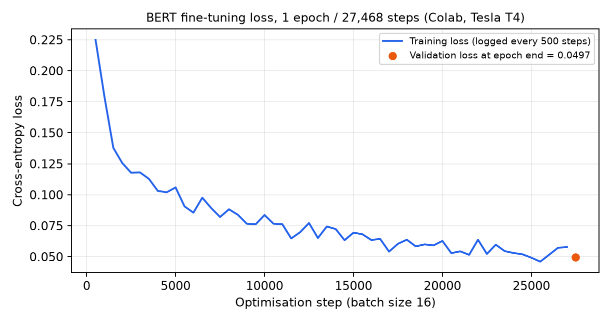
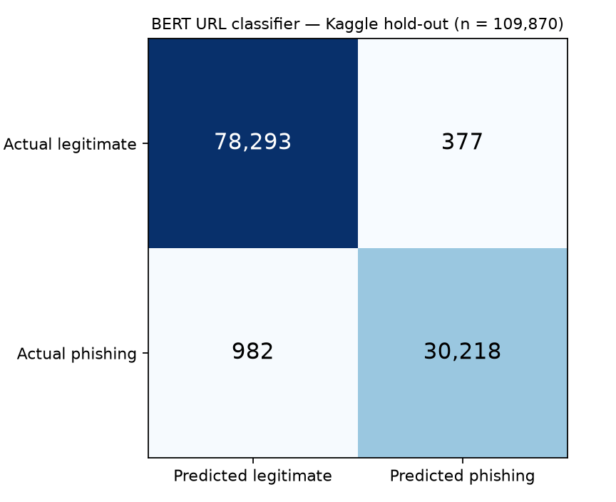
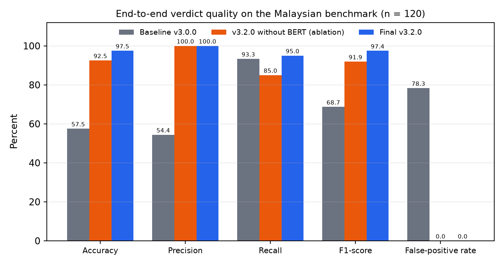
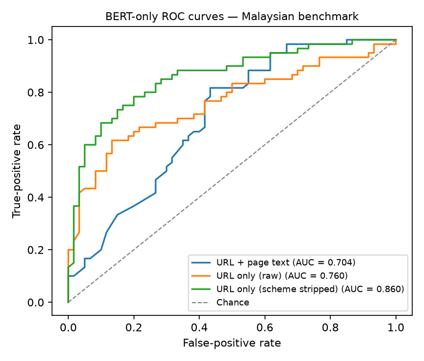
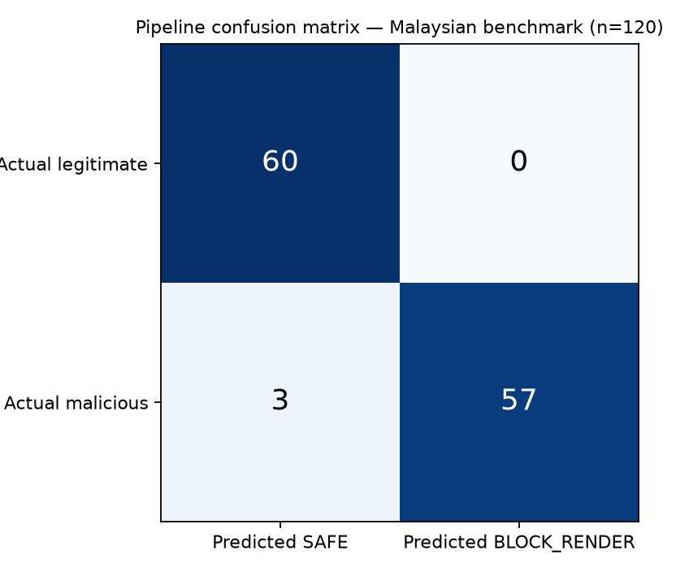
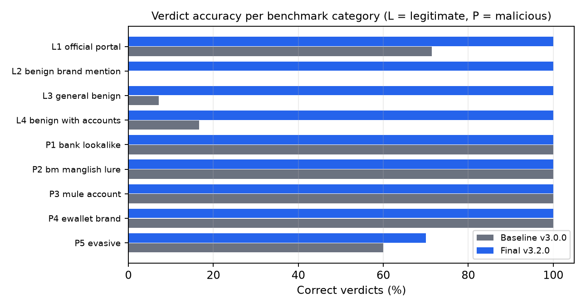
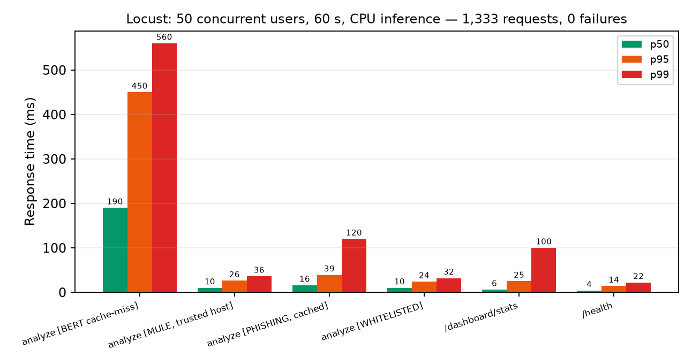

<!-- Generated from PhishGuard-AI_Project_1_&_2_Report_LiewYiLer.docx (v3.2.0, 16 November 2026). The Word document is the authoritative version; edit it, not this file. -->

# Chapter 5

## Implementation and Testing

### 5.1 Introduction

The Implementation and Testing phase represents the practical engineering realisation and empirical verification of the **Semantic Threat Intelligence and Mule Account Verification Engine** developed as an individual module by Liew Yi Ler. Translating the theoretical methodologies established in Chapter 3 and the structural blueprints designed in Chapter 4 into a resilient, production-ready cybersecurity system mandates rigorous coding standards, optimised data science pipelines, and hardware-accelerated deep learning execution (Kreuzberger et al., 2023).

This chapter documents:

- The dual computational environment architecture separating cloud-based GPU model training from local high-throughput ASGI microservice hosting.
- The Extract, Transform, Load (ETL) data sanitisation and feature engineering pipelines operating on over 549,000 cybersecurity records.
- The fine-tuning of the Transformer-based **Bidirectional Encoder Representations from Transformers (BERT)** model (Devlin et al., 2018) utilising PyTorch (Paszke et al., 2019), WordPiece subword tokenisation (Wu et al., 2016), and AdamW optimisation (Loshchilov & Hutter, 2019).
- The asynchronous backend implementation on **FastAPI** and **Uvicorn** (Bansal & Ouda, 2022), integrating asyncio.to_thread() tensor offloading, asyncio.gather() parallel execution, pre-compiled C-level Regular Expression bytecode, and an asynchronous SQLite database connection.
- The identification, through a labelled Malaysian benchmark, of a severe false-positive defect in the original decision logic, and its replacement by a corroborated verdict engine.
- Empirical evaluation of the BERT classifier on the 109,870-record hold-out set (accuracy 98.76%, F1-score 97.80%) and of the complete pipeline on a 120-page Malaysian benchmark (accuracy 97.50% with no false positives) (Sokolova & Lapalme, 2009).
- Load testing with Locust: 22.4 requests per second with no errors at 50 concurrent users (median 13 ms, 95th percentile 370 ms), and identification of the saturation point of a single CPU worker.
- Continuous Integration / Continuous Deployment (CI/CD) validation via a 198-test automated Pytest suite (all passing) with 77% statement and branch coverage.

### 5.2 Environment Setup and Data Engineering Pipeline

*[Figure: see the Word report]*

#### 5.2.1 Computational Environments & Hardware Bifurcation

To optimise development efficiency and respect hardware constraints, computational tasks were bifurcated into two specialised operating environments:

- **Model Fine-Tuning Environment (Google Colab)**: Fine-tuning a 110-million-parameter Transformer on 439,476 sequences is impractical on a CPU. Training ran on an NVIDIA Tesla T4 GPU with the CUDA 12.8 runtime (PyTorch 2.11, Transformers 5.9) and took 3 hours 3 minutes for 27,468 optimisation steps.
- **Production Inference & Microservice Environment (Local Windows 11 Host)**: The FastAPI microservice, Uvicorn ASGI server and SQLite persistence layer run on an AMD Ryzen 7 5700G (8 cores, 16 threads, 32 GB RAM) under Python 3.14.3. No GPU is used: every inference and latency figure in this chapter is a CPU measurement.

#### 5.2.2 Dataset Ingestion & Preprocessing Pipeline

The training corpus is a single public dataset; Malaysian content was used for evaluation only:

- **Global Phishing Corpus (Kaggle)**: 549,346 labelled URL strings (Tiwari, n.d.), each labelled good or bad. The file contains URLs only, without page content.
- **Malaysian Evaluation Benchmark**: 120 hand-curated pages (60 legitimate, 60 malicious) in English, Bahasa Melayu and Manglish, described in Section 5.5.2. It was not used for training.
Because the corpus is already tabular, the preparation needed for fine-tuning is short. Listing 5.1 reproduces it from the Colab notebook (pandas; McKinney, 2011). The BeautifulSoup sanitiser (Richardson, 2022) described in Chapter 4 operates at inference time on page content, not on the training data.

**Listing 5.1: Data Preparation and Tokenisation (Colab notebook, steps 3–4)**

```
# 3. LOAD & CLEAN ALL DATA (500k+ URLs)
df = pd.read_csv('/content/phishing_site_urls.csv')
df = df.dropna(subset=['URL', 'Label'])
df['Label'] = df['Label'].str.lower()
df['label'] = df['Label'].map({'good': 0, 'bad': 1})
df = df.dropna(subset=['label'])
df['label'] = df['label'].astype(int)

# Split into Training (80%) and Testing (20%)
train_df, test_df = train_test_split(df, test_size=0.2, random_state=42)
train_dataset = Dataset.from_pandas(train_df)
test_dataset = Dataset.from_pandas(test_df)

# 4. TOKENIZATION
tokenizer = BertTokenizer.from_pretrained('bert-base-uncased')

def tokenize_function(examples):
    return tokenizer(examples["URL"], padding="max_length", truncation=True, max_length=128)

train_dataset = train_dataset.map(tokenize_function, batched=True)   # 439,476 examples
test_dataset = test_dataset.map(tokenize_function, batched=True)     # 109,870 examples
```

#### 5.2.3 Critical Null-Handling & Float-Casting Anomaly Resolution

Two details of Listing 5.1 matter for correctness. Label strings are lower-cased before mapping, so that variants such as Good and good receive the same class.

Rows whose label cannot be mapped are then dropped and the column is cast explicitly to an integer type. Without the cast, pandas infers a floating-point column as soon as a single value is missing, and the classification loss, which requires integer class indices, cannot be computed.

### 5.3 Deep Learning Model Implementation (BERT Fine-Tuning)

*[Figure: see the Word report]*

#### 5.3.1 Tokenisation & Tensor Formulation

The URL strings were transformed into dense numerical vectors using BertTokenizer.from_pretrained('bert-base-uncased'). WordPiece subword tokenisation (Wu et al., 2016) dynamically splits unknown or obfuscated words into subword units (e.g., decomposing rnaybank into rn, ##ay, ##bank), preserving the semantic root of typosquatted banking brands.

Sequences were padded or truncated to a uniform maximum sequence length of N = 128 tokens:

*[Figure: see the Word report]*

Attention masks  were simultaneously constructed to instruct the Transformer self-attention heads (Vaswani et al., 2017) to allocate zero attention weight to [PAD] positions .

#### 5.3.2 Model Instantiation & Hyperparameter Tuning

The model was instantiated using BertForSequenceClassification from Hugging Face (Wolf et al., 2020), replacing the top masked language modelling head with a linear Multi-Layer Perceptron (MLP) binary classification layer. The training hyperparameters were tuned to preserve the foundational pre-trained semantic weights while adapting to the lexical patterns of phishing URLs, as detailed in Table 5.1.

**Table 5.1: BERT Model Hyperparameter Configuration**

| Hyperparameter | Value Assigned | Engineering Rationale & Justification |
| --- | --- | --- |
| Foundation Model | bert-base-uncased | 110M parameters, 12 Transformer layers, 768 hidden dimensions, 12 attention heads. |
| Optimization Algorithm | AdamW | Decoupled weight decay (lambda = 0.01) prevents overfitting on dominant keywords. |
| Learning Rate (eta) | 2.0 x 10^{-5} | Conservative learning rate preventing catastrophic forgetting of foundational syntax. |
| Learning Rate Schedule | Linear decay, no warm-up | Hugging Face Trainer default: the learning rate falls linearly from 2e-5 to 0 over the 27,468 steps. |
| Batch Size (B) | 16 | Maximises memory throughput on the Tesla T4 (16 GB VRAM) without CUDA OOM crashes. |
| Maximum Sequence Length | 128 Tokens | URLs are short; 128 tokens covers almost all of them while keeping tensors small. |
| Training Epochs | 1.0 epoch (27,468 steps) | One pass over 439,476 URLs fits within a single Colab session (3 h 03 min); the training loss had flattened by the end of the epoch (Figure 5.3). |

#### 5.3.3 Training Convergence & Loss Profile

The model was trained for 27,468 optimisation steps. The Trainer logged the training loss every 500 steps and, because evaluation was configured per epoch, computed validation metrics once, at the end of the epoch. Table 5.2 reproduces the log; Figure 5.3 plots the full loss curve.

**Table 5.2: BERT Training Log (training loss every 500 steps; validation at epoch end)**

| Optimisation Step / Epoch | Training Loss | Validation Loss | Validation Accuracy | F1-Score | Precision | Recall |
| --- | --- | --- | --- | --- | --- | --- |
| Step 500 / 0.02 | 0.224992 | — | — | — | — | — |
| Step 5,000 / 0.18 | 0.105894 | — | — | — | — | — |
| Step 10,000 / 0.36 | 0.083649 | — | — | — | — | — |
| Step 15,000 / 0.55 | 0.069425 | — | — | — | — | — |
| Step 20,000 / 0.73 | 0.062735 | — | — | — | — | — |
| Step 25,000 / 0.91 | 0.049219 | — | — | — | — | — |
| Step 27,000 / 0.98 | 0.057774 | — | — | — | — | — |
| Step 27,468 / 1.00 (Final) | 0.057774 | 0.049662 | 0.987631 | 0.978008 | 0.987678 | 0.968526 |



**Figure 5.3: Training Loss over 27,468 Steps and Validation Loss at Epoch End**

At the conclusion of training, the model weights were serialised in the high-speed **Safetensors** binary format (model.safetensors, 438 MB), reducing memory footprint and load times.

### 5.4 Asynchronous Backend Engineering & Microservice Orchestration

The FastAPI application server coordinates high-throughput incoming traffic via non-blocking asynchronous routines, leveraging asyncio.gather() and asyncio.to_thread() to bridge synchronous PyTorch tensor computations with high-concurrency event loops (Bansal & Ouda, 2022):

**Listing 5.2: Analysis Endpoint (api/endpoints.py, abridged; cache handling and logging omitted)**

```
@router.post("/analyze/semantics", response_model=AnalysisResponse, status_code=200)
@limiter.limit(RATE_LIMIT)                                   # 60/minute per client IP
async def analyse_semantics(payload: WebPayload, request: Request,
                            _api_key: str = Depends(verify_api_key)) -> AnalysisResponse:
    raw_content = payload.dom_content or payload.text_content or ""
    sanitized_text = sanitize_dom(raw_content) or "empty page content"
    url_str = str(payload.url)
    is_trusted = _is_trusted_domain(url_str)

    if is_trusted:                                           # whitelist: skip BERT
        bert_result = {"label": "LEGITIMATE", "confidence": TRUSTED_DOMAIN_CONFIDENCE,
                       "is_malicious": False}
        mule_result = await mule_scanner.scan_and_verify(sanitized_text, db)
    else:
        model_input = build_model_input(url_str)             # scheme-stripped URL
        bert_result, mule_result = await asyncio.gather(
            semantic_engine.predict(model_input),            # asyncio.to_thread inside
            mule_scanner.scan_and_verify(sanitized_text, db),
        )

    decision = decide(
        is_trusted=is_trusted, bert_result=bert_result, mule_result=mule_result,
        brand_result=profile_brand_impersonation(url_str, sanitized_text),
        heuristic_result=analyze_url_heuristics(url_str),
        sanitized_text=sanitized_text, raw_content=raw_content,
    )

    if decision.is_threat:                                   # persist + one SSE broadcast
        await log_threat_telemetry(url=url_str, score=decision.risk_score, db=db)

    return AnalysisResponse(..., orchestration=decision.verdict,
                            decision_rule=decision.rule,
                            threat_indicators=decision.indicators, signals=decision.signals)
```

#### 5.4.1 Lifespan Management & Model Singleton Pattern

To prevent prohibitive disk I/O bottlenecks during active user browsing requests, the PyTorch BERT model (440 MB) is loaded into system RAM strictly once during the server lifespan startup phase:

**Listing 5.3: Lifespan Management (main.py, abridged)**

```
@asynccontextmanager
async def lifespan(app: FastAPI) -> AsyncIterator[None]:
    app.state.db = await initialize_database()               # DDL, indexes, seed data, WAL
    if ENABLE_SEMANTIC_ENGINE:
        engine = SemanticEngine()                            # loads BERT once (438 MB)
        engine.warm_up()                                     # dummy forward pass
        app.state.semantic_engine = engine
    else:
        app.state.semantic_engine = None
    app.state.mule_scanner = MuleScanner()                   # compiles the regex patterns
    app.state.cache = SemanticResultCache(ttl_seconds=600)
    app.state.simulator_running = False                      # demo simulator is off by default
    simulator_task = asyncio.create_task(simulate_live_threats(app.state))
    yield                                                    # application serves requests
    if app.state.semantic_engine is not None:
        app.state.semantic_engine.shutdown()
    simulator_task.cancel()
    await app.state.db.close()
```

#### 5.4.2 Simulated Semakmule Database Expansion

To support integration testing and demonstration, the mule_registry table is seeded at start-up with 18 simulated entries: 15 bank accounts across 8 Malaysian banks, two DuitNow mobile proxies and one NRIC proxy (Table 5.3). The entries are fictitious and stand in for the PDRM CCID Semakmule registry (PDRM, 2023), to which the project has no live access.

**Table 5.3: Seed Data of the Simulated Mule Account Registry (18 entries)**

| Account Number | Bank Affiliation | Platform Flagged | Simulated Report Count | Identifier Type |
| --- | --- | --- | --- | --- |
| 112233445566 | Maybank | Shopee | 14 | Bank account |
| 564738291012 | Maybank | Facebook Marketplace | 8 | Bank account |
| 76001234567890 | CIMB Bank | WhatsApp | 7 | Bank account |
| 70009876543210 | CIMB Bank | Carousell | 5 | Bank account |
| 3112233445 | Public Bank | Telegram | 3 | Bank account |
| 3998877665 | Public Bank | Lazada | 11 | Bank account |
| 21234567890123 | RHB Bank | Mudah.my | 6 | Bank account |
| 012345678901 | Hong Leong Bank | WhatsApp | 2 | Bank account |
| 234567890123 | Hong Leong Bank | Facebook Marketplace | 9 | Bank account |
| 8123456789012 | AmBank | Shopee | 4 | Bank account |
| 14001234567890 | Bank Islam | Telegram | 10 | Bank account |
| 012345678912 | Bank Rakyat | Lazada | 1 | Bank account |
| 212345678901 | Bank Rakyat | Carousell | 13 | Bank account |
| 156789012345 | Maybank | Mudah.my | 22 | Bank account |
| 3567891234 | Public Bank | Shopee | 17 | Bank account |
| 0123456789 | DuitNow (Maybank) | WhatsApp Scam | 19 | DuitNow mobile proxy |
| 0198765432 | DuitNow (CIMB) | Telegram Scam | 15 | DuitNow mobile proxy |
| 980102-14-5678 | DuitNow (NRIC) | Facebook Marketplace | 8 | NRIC proxy |

### 5.5 Empirical System Testing and Performance Evaluation

#### 5.5.1 Evaluation of the BERT URL Classifier on the Hold-out Set

At the end of the training epoch the model was evaluated once on the 109,870 hold-out URLs. Table 5.4 gives the logged metrics. The notebook did not save the confusion matrix itself; however, because the split size and the four logged metrics are exact, the four cells are uniquely determined. The script evaluation/kaggle_holdout_metrics.py solves for them and verifies that they reproduce every logged metric to within floating-point precision (Figure 5.4).

**Table 5.4: BERT Hold-out Results (109,870 URLs: 31,200 phishing, 78,670 legitimate)**

| Metric | Calculation | Value |
| --- | --- | --- |
| Accuracy | (TP + TN) / N = (30,218 + 78,293) / 109,870 | 98.76% |
| Precision | TP / (TP + FP) = 30,218 / 30,595 | 98.77% |
| Recall (sensitivity) | TP / (TP + FN) = 30,218 / 31,200 | 96.85% |
| F1-score | 2PR / (P + R) | 97.80% |
| Specificity | TN / (TN + FP) = 78,293 / 78,670 | 99.52% |
| False-positive rate | FP / (FP + TN) = 377 / 78,670 | 0.48% |
| False-negative rate | FN / (FN + TP) = 982 / 31,200 | 3.15% |
| Validation loss / final training loss | Cross-entropy | 0.0497 / 0.0578 |



**Figure 5.4: Confusion Matrix of the BERT URL Classifier on the Hold-out Set**

These figures need to be interpreted critically. The validation loss is lower than the final training loss, which gives no sign of over-fitting within the corpus. The split, however, is random: URLs from the same phishing campaign and the same host appear on both sides of it, which is the leakage that Arp et al. (2022) and Dalton et al. (2025) identify as a source of optimistic results. The class ratio of the hold-out set (28% phishing) is also far from the base rate a browser extension encounters. The hold-out score therefore shows that the model learned the corpus; it does not show how the model behaves on Malaysian pages. Two further limitations are recorded for completeness: no ROC-AUC can be reported for this split because per-sample scores were not saved, and no intermediate validation points exist because evaluation ran once.

#### 5.5.2 End-to-End Evaluation on the Malaysian Benchmark

To test the complete pipeline on the content it is meant to protect, a labelled benchmark of 120 pages was built (evaluation/datasets/malaysia_eval_v1.jsonl). Table 5.5 shows its composition. Legitimate samples use the real public domain of the organisation; malicious samples use fictitious domains modelled on publicly reported Malaysian scam patterns. Each sample is a small HTML document, and pages that would realistically present a login, OTP or card form carry that form, whether they are legitimate or not. The samples are divided equally into a development split, used while tuning the rule layer, and a held-out split that was not inspected during tuning.

**Table 5.5: Composition of the Malaysian Evaluation Benchmark**

| Category | Label | Samples | Content |
| --- | --- | --- | --- |
| L1 Official portals | Legitimate | 14 | Internet-banking, e-wallet and government portals (Maybank2u, CIMB Clicks, PBe, RHB, Hong Leong Connect, AmOnline, Bank Islam, iRakyat, myBSN, LHDN, KWSP, BNM, Semak Mule). |
| L2 Benign brand mentions | Legitimate | 20 | News articles, comparison sites, forums and guides that name banks, in English and Bahasa Melayu. |
| L3 General benign | Legitimate | 14 | Malaysian retail, telecommunication, travel, education and recipe sites, including a member login page. |
| L4 Benign with account numbers | Legitimate | 12 | Charity, school, club and small-business pages that publish their own bank account or phone numbers. |
| P1 Bank look-alikes | Malicious | 14 | Credential-harvesting clones on typosquatted, punycode, raw-IP and deep-subdomain hosts. |
| P2 Bahasa Melayu / Manglish lures | Malicious | 14 | LHDN refund, PDRM and JPJ summons, KWSP withdrawal, cash-aid and utility lures; one Chinese-language sample. |
| P3 Mule-account pages | Malicious | 12 | Marketplace, rental, job and loan scams asking for payment into a registry account. |
| P4 E-wallet and global brands | Malicious | 10 | Touch 'n Go, GrabPay, ShopeePay, DuitNow, PayPal, Netflix, Binance and Apple ID lures. |
| P5 Evasive | Malicious | 10 | Neutral hostnames, shared-hosting subdomains, a Google Forms page, a sparse loading page and an investment scam. |

The script evaluation/evaluate_pipeline.py loads the real fine-tuned model, seeds an in-memory registry exactly as at start-up, and sends every sample through POST /api/v1/analyze/semantics. A BLOCK_RENDER verdict counts as a positive prediction. The script was first run against the code as it stood at the start of Project II (version 3.0.0), then against the final version 3.2.0, and finally against version 3.2.0 with the BERT signal disabled as an ablation. Table 5.6 and Figure 5.5 give the results.

**Table 5.6: Pipeline Verdict Quality on the Malaysian Benchmark (n = 120)**

| Configuration | TP | FP | FN | TN | Accuracy | Precision | Recall | F1 | FPR |
| --- | --- | --- | --- | --- | --- | --- | --- | --- | --- |
| Baseline v3.0.0 | 56 | 47 | 4 | 13 | 57.50% | 54.37% | 93.33% | 68.71% | 78.33% |
| Final v3.2.0 | 57 | 0 | 3 | 60 | 97.50% | 100.00% | 95.00% | 97.44% | 0.00% |
| development split (n = 60) | 28 | 0 | 2 | 30 | 96.67% | 100.00% | 93.33% | 96.55% | 0.00% |
| held-out split (n = 60) | 29 | 0 | 1 | 30 | 98.33% | 100.00% | 96.67% | 98.31% | 0.00% |
| v3.2.0 without BERT (ablation) | 51 | 0 | 9 | 60 | 92.50% | 100.00% | 85.00% | 91.89% | 0.00% |



**Figure 5.5: Baseline, Ablation and Final Pipeline Results on the Malaysian Benchmark**

**The baseline result exposed a serious defect.** Version 3.0.0 detected 56 of the 60 malicious pages but also blocked 47 of the 60 legitimate ones, a false-positive rate of 78.33%. Every one of the twenty news and forum pages that merely mentioned a bank was blocked, as were 13 of 14 ordinary Malaysian sites and four official internet-banking portals. A tool that blocks most of the legitimate web would be removed by its users within minutes, so this defect outweighed every other finding of the project. Per-sample inspection of the development split identified three root causes:

- **Train–inference mismatch:** The model had been fine-tuned on bare URL strings but was being fed "URL: <url> | <page text>". On that input it labelled all 120 pages as phishing (Table 5.7).
- **Single-signal blocking:** A BERT verdict alone, or a bank name anywhere in the page text, was sufficient to block. Both conditions are common on legitimate pages.
- **Substring keyword matching and whitelist gaps:** Credential keywords were matched as substrings, so that pin matched shopping; and four official hosts (AmOnline, Bank Islam, iRakyat and myBSN) were missing from the whitelist while several shared-hosting suffixes were wrongly included in it.
**Table 5.7: BERT Used Alone on the Malaysian Benchmark, by Input Formulation (threshold 0.75)**

| BERT input | Accuracy | Precision | Recall | False-positive rate | ROC-AUC |
| --- | --- | --- | --- | --- | --- |
| URL and page text (as in v3.0.0) | 50.00% | 50.00% | 100.00% | 100.00% | 0.704 |
| URL as received, with scheme | 53.33% | 51.85% | 93.33% | 86.67% | 0.760 |
| URL without scheme or www (v3.2.0) | 72.50% | 67.09% | 88.33% | 43.33% | 0.860 |



**Figure 5.6: ROC Curves of BERT Alone on the Malaysian Benchmark for Three Input Formulations**

Table 5.7 and Figure 5.6 quantify the first root cause and the limits of the model. Restoring the input to the form used in training raises the ROC-AUC from 0.704 to 0.860, a substantial gain obtained without retraining. Even so, the classifier that scores 98.76% on its own hold-out set reaches only 72.50% accuracy on Malaysian pages and flags 43.33% of the legitimate ones, because legitimate deep links such as maybank2u.com.my/home/m2u/common/login.do resemble the phishing URLs it was trained on. This is the distribution shift anticipated in Section 2.6.3, and it is the empirical justification for the corroborated design: BERT is informative, but it cannot be trusted to block alone.

**The final result.** Version 3.2.0 blocks 57 of the 60 malicious pages and none of the 60 legitimate ones (Figure 5.7). All 14 official portals, all 20 pages that merely mention a bank and all 12 pages that publish their own account numbers are now passed. The held-out split, which was not consulted while tuning, scores slightly higher than the development split (98.33% against 96.67%), which indicates that the rules were not fitted to individual development samples. Table 5.8 shows which rule produced each block, and Figure 5.8 compares accuracy per category before and after.



**Figure 5.7: Confusion Matrix of the Final Pipeline (v3.2.0) on the Malaysian Benchmark**

**Table 5.8: Rule Responsible for Each BLOCK_RENDER Verdict (v3.2.0, 57 blocked pages)**

| Rule | Pages blocked | Typical sample |
| --- | --- | --- |
| R1 Mule registry | 12 | Marketplace listing asking for payment into a registered account. |
| R2 Brand in hostname | 29 | maybank2u-secure-login.top, pdrm-saman-online.net, tng-ewallet-cashback.top. |
| R3 Look-alike domain | 5 | rnaybank2u.com, maybznk2u.com.my, pbbank-online.xyz. |
| R4 Brand clone | 7 | Maybank2u login form on secure-portal-update.com; a clone served from a raw IP address; a payroll lure requesting Microsoft 365 credentials. |
| R5 Coercive credential request | 2 | Cash-aid lure and a Chinese-language account-freeze lure, each with a credential form and urgency wording. |
| R6 Evasive infrastructure | 2 | Subsidy and court-notice lures on disposable top-level domains. |



**Figure 5.8: Verdict Accuracy per Benchmark Category, Baseline versus Final**

**Contribution of BERT.** With the BERT signal disabled, precision is unchanged but recall falls from 95.00% to 85.00%: six pages are no longer caught. Four are evasive clones on neutral hostnames, for which the URL classifier supplies the corroboration that rule R4 needs, and two are Bahasa Melayu lures on disposable domains that depend on rule R6. The model therefore earns its place as a supporting signal, adding ten percentage points of recall at no cost in false positives, while the hostname and registry rules carry most of the detections.

**Remaining errors.** Three malicious pages are missed: a page that shows only a loading message on a neutral domain, an investment scam that asks for a deposit without requesting credentials, and a phishing form hosted on Google Forms, a whitelisted domain. The first two carry too little evidence for any rule, and the third is an inherent cost of whitelisting a platform on which users can publish. They are treated as limitations in Section 6.5 rather than tuned away.

**Threats to validity.** The benchmark is small, so each sample moves a headline figure by almost one percentage point, and a confidence interval around a 0% false-positive rate on 60 samples is wide. The page text was written by the author, who also designed the rules; although the held-out split guards against fitting to specific samples, the benchmark and the rules reflect the same understanding of Malaysian scams, and unfamiliar patterns will fare worse. Baseline errors on both splits were inspected when correcting the whitelist. Mule samples refer to seeded registry accounts and so measure the mechanism, not the coverage of a real registry. The results should therefore be read as evidence that the pipeline behaves as designed on representative patterns, and as a regression benchmark for future changes, not as an estimate of field accuracy.

#### 5.5.3 Load and Latency Testing (Locust)

Latency was measured in two ways. In the benchmark run above, each request was timed inside the server: the BERT path took a mean of 108 ms (95th percentile 115 ms) for a single client, and the whitelist bypass a mean of 0.28 ms. Concurrent behaviour was then measured with Locust 2.44.4 (Heyman et al., 2024) against a running Uvicorn server with one worker process and the real model on CPU. Locust ran on the same machine, so client and server shared the same cores. Each simulated user waits one to three seconds between requests and chooses among six tasks: a non-whitelisted page with a unique URL, which forces a real BERT forward pass (weight 3); a whitelisted page (2); a phishing page whose BERT result is cached (1); a mule page on a trusted host (1); the health probe (2); and the dashboard statistics (1). All simulated users share one IP address, so the per-IP rate limit was lifted for the throughput runs and restored for a third run that tests the limiter itself.

**Table 5.9: Locust Load-Test Results (CPU inference, single Uvicorn worker)**

| Run | Rate limit | Requests | Errors | Throughput | p50 | p95 | p99 | Max |
| --- | --- | --- | --- | --- | --- | --- | --- | --- |
| 50 users, 60 s | Lifted | 1,333 | 0 (0.00%) | 22.39 req/s | 13 ms | 370 ms | 490 ms | 600 ms |
| BERT cache-miss path only |  | 401 | 0 | 6.73 req/s | 190 ms | 450 ms | 560 ms | 600 ms |
| whitelist path only |  | 283 | 0 | 4.75 req/s | 10 ms | 24 ms | 32 ms | 139 ms |
| 200 users, 60 s | Lifted | 2,418 | 0 (0.00%) | 40.40 req/s | 96 ms | 11,000 ms | 12,000 ms | 12,266 ms |
| BERT cache-miss path only |  | 640 | 0 | 10.69 req/s | 9,700 ms | 12,000 ms | 12,000 ms | 12,266 ms |
| 50 users, 45 s | Default 60/minute | 1,014 | 646 (63.71%), all HTTP 429 | 23.04 req/s | 3 ms | 17 ms | 230 ms | 584 ms |



**Figure 5.9: Response-Time Percentiles per Request Type at 50 Concurrent Users**

At 50 concurrent users the service handled 1,333 requests without a single failure. The uncached BERT path had a median of 190 ms and a 99th percentile of 560 ms. Measured against the 400 ms target of NFR 2.1 and Objective 3, the result is mixed: across all request types 95% of requests completed within 370 ms, but on the uncached BERT path alone the target is met at the median and missed at the 95th percentile (450 ms). Every request completed in well under one second. Whitelisted and cached requests complete in tens of milliseconds, which matters in practice because most browsing is to well-known sites.

The 200-user run locates the capacity limit. Throughput on the BERT path rose only to 10.69 requests per second while its median latency climbed to 9.7 seconds: a single CPU worker sustains roughly ten to eleven uncached inferences per second, and beyond that rate requests queue. No request failed, and whitelisted requests were still served with a median of 45 ms, which shows that asyncio.to_thread keeps the event loop responsive while inference is saturated. Capacity can be raised with additional worker processes, GPU inference or a distilled model; these options are discussed in Section 6.5.

In the third run the default limit of 60 requests per minute was active. The limiter admitted 60 analysis requests and rejected the remaining 646 with HTTP 429, while the health probe continued to be served. This is the intended behaviour and confirms that a single client cannot exhaust the inference capacity measured above.

#### 5.5.4 Automated Test Suite and Coverage (Pytest)

The codebase is covered by 198 automated tests in ten modules, built on pytest and pytest-asyncio and executed against the FastAPI application through httpx.AsyncClient. All 198 pass (12.76 s with coverage measurement). The suite grew from 122 tests during Project II: the new modules test the verdict engine, the security controls and the mule-report queue (Table 5.10). The same suite runs in the GitHub Actions workflow on every push.

**Table 5.10: Automated Test Suite Summary**

| Test module | Tests | Scope | Result |
| --- | --- | --- | --- |
| tests/test_endpoints.py | 25 | Bearer authentication, schema validation, status codes, whitelist behaviour, corroborated blocking, quishing endpoint. | Pass |
| tests/test_enhancements.py | 46 | Dashboard operations, exports (STIX, CEF, Syslog), brand profiler, playbooks, quishing decoding. | Pass |
| tests/test_verdict_engine.py | 43 | Word-boundary credential matching, form detection, brand tiers, URL heuristics, rules R1–R6, scorer regressions. | Pass |
| tests/test_security.py | 20 | Dashboard authentication (bearer and session cookie), login rate limit, CORS, security headers, single SSE broadcast, registry-poisoning regression. | Pass |
| tests/test_mule_scanner.py | 14 | Bank-specific regex extraction and registry matching. | Pass |
| tests/test_sanitizer.py | 13 | Removal of script and style content, text normalisation. | Pass |
| tests/test_mule_reports.py | 12 | Report queue, input validation, approve and reject flows, foreign-key behaviour. | Pass |
| tests/test_nlp_engine.py | 9 | Engine interface, label mapping and thresholding (mocked model). | Pass |
| tests/test_repository.py | 8 | Parameterised queries, telemetry logging, constraint enforcement. | Pass |
| tests/test_visual.py | 8 | Visual endpoint contract and logo–domain evaluation (mocked detector). | Pass |
| Total | 198 |  | 198 / 198 |

Coverage was measured with pytest-cov, counting both statements and branches. Overall coverage is 77% (2,788 statements, of which 542 are not executed; 668 branches). The decision-critical modules are well covered: the verdict engine 95%, the brand profiler 98%, the repository 98%, the mule scanner 91% and the security module 91%. Table 5.11 lists the least-covered modules with the reason in each case. The unit tests replace the BERT model with a mock and use an in-memory database, so that they run in seconds and in continuous integration; the real model is exercised by the benchmark of Section 5.5.2 and the load test of Section 5.5.3.

**Table 5.11: Least-Covered Modules**

| Module | Coverage | Reason |
| --- | --- | --- |
| services/webhook_notifier.py | 27% | Outbound calls to Discord, Slack and Telegram are not made in tests. |
| services/visual_sandbox.py | 37% | Requires a headless browser. |
| main.py | 42% | The lifespan start-up, the demonstration simulator loop and the documentation page are not run under the test client. |
| services/visual_detector.py | 44% | YOLO inference is mocked. |
| services/nlp_engine.py | 56% | The real BERT forward pass is mocked in unit tests. |

#### 5.5.5 Live SOC Threat Intelligence Dashboard

The administrative Threat Intelligence Dashboard (/dashboard/), available after administrative sign-in, visualises system telemetry as it is recorded:

- **Server-Sent Events (SSE)**: Streams intercepted threats to connected SOC analysts with zero browser polling overhead (GET /api/v1/dashboard/stream).
- **24-Hour Threat Velocity Spectrum (GMT+8)**: Renders a continuous diurnal attack wave in Malaysia Standard Time with interactive [ 24h ] [ 12h ] [ 8h ] range switchers.
- **Geographic Attack Radar**: Assigns each telemetry record to one of six representative hosting regions for visualisation. The assignment is illustrative; the system does not resolve the real network origin of a threat.
- **Case Summary Export**: Formats incident telemetry into a structured summary suitable for a report to the National Scam Response Centre (NSRC 997). The system does not transmit anything to a government service.
- **Demonstration Simulator:** An optional background task, switched off by default, inserts synthetic telemetry so that the dashboard can be demonstrated without live traffic. Synthetic records are not included in any figure reported in this chapter.

### 5.6 Chapter Summary

This chapter has documented the implementation and empirical verification of the **PhishGuard-AI** backend platform.

Key empirical milestones achieved in this chapter include:

- **Model Fine-Tuning**: Fine-tuned BERT Base Uncased for one epoch on 439,476 URLs, reaching 98.76% accuracy, 98.77% precision, 96.85% recall and a 97.80% F1-score on the 109,870-URL hold-out set.
- **False-Positive Correction**: A 120-page Malaysian benchmark showed that the original logic blocked 78.33% of legitimate pages. The corroborated verdict engine reduced this to 0% while raising recall from 93.33% to 95.00%; an ablation attributes ten percentage points of recall to the BERT signal.
- **Measured Latency and Capacity**: At 50 concurrent users the service handled 22.4 requests per second with no errors (median 13 ms, 95th percentile 370 ms; uncached BERT path median 190 ms). A single CPU worker saturates at about ten to eleven uncached inferences per second.
- Automated Test Validation: 198 of 198 automated Pytest test cases pass, with 77% statement and branch coverage.
These empirical results provide mathematical and operational validation for the system. The subsequent and final chapter **Chapter 6: Discussions and Conclusion** synthesises project achievements, reviews academic limitations, and outlines future research trajectories.
